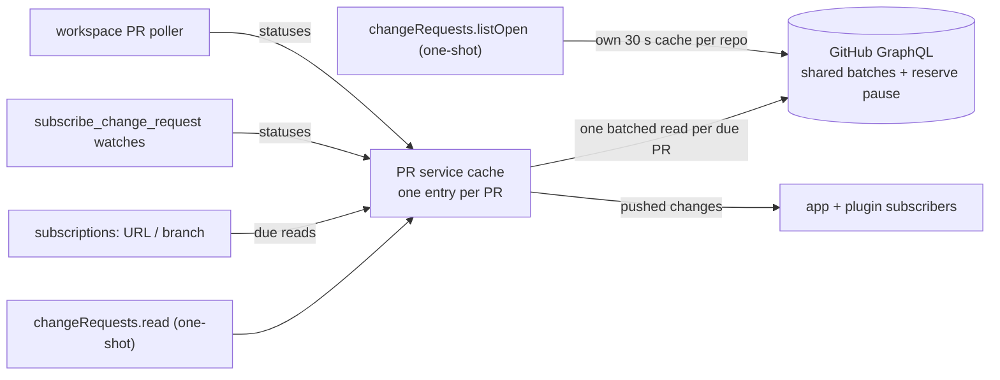

# Pull request service

The daemon is the only thing that fetches pull request data from a forge. Core and plugins subscribe to the PRs they care about; the daemon fetches each PR once, at the pace the PR needs, and pushes changes to every subscriber. Nobody polls GitHub on their own clock.

Before this, five things fetched the same PRs separately: core's workspace poller, paseo-prs (`gh pr list --head` per checkout every 2 minutes), paseo-asks (a deployments query per watched PR every 2 minutes), paseo-inbox, and agents running `gh pr checks --watch`. Together they spent about 3,850 of the 5,000 GraphQL points an hour, the daemon paused all PR reads at its 40% reserve for 25 minutes at a time, and every surface went stale at once. `gh api rate_limit` doesn't show this: REST's `/rate_limit` does not count GraphQL points. Ask GraphQL's own `rateLimit { used remaining resetAt cost }`.

## One cache, many feeders

`createPullRequestService` (`packages/server/src/services/pull-request-service.ts`) owns one cache entry per canonical PR URL. Every forge read core makes lands in it:



- A subscription's due read for a PR the workspace poller or a watch read within the last 30 s is skipped: the service takes that status instead.
- A workspace poll also stands in for the lookup of its branch: the poller finds the branch's PR on every poll, so a followed lookup of the same repository and head branch is pushed back to its next due time instead of asking the forge again. A PR the poll finds that the branch list doesn't have yet is added to it.
- `changeRequests.read` is a one-shot over the same cache (30-second TTL, in-flight reads shared). It stays for plugins that only need a value once.
- The workspace poller keeps its own query: it reads merge policy and auto-merge facts per checkout (merge methods, auto-merge, merge queue, `viewerCanUpdateBranch`) that no subscriber needs, and moving those into the service's query would make every plugin read heavier. It feeds the cache; it doesn't read from it. Its own cadence follows the same tiers (`computeGithubNextInterval` in `services/github-service.ts`): 20 s while checks run, 120 s while the branch has no PR yet, 10 minutes otherwise. Every client observes every workspace in its sidebar, so an observed workspace is not one someone is looking at.

## Subscriptions

Plugin servers:

```ts
const sub = await paseo.changeRequests.subscribe(
  {
    urls: ["https://github.com/acme/widgets/pull/42"],
    branches: [
      { repo: "https://github.com/acme/widgets", headRef: "feat/login", includeClosed: false },
    ],
    priority: "visible", // or "background" (default)
    include: ["deployments"], // opt-in facts that cost extra points
  },
  (update) => {
    /* update.results, update.branches: only what changed */
  },
);
sub.initial; // every result and branch at subscribe time
await sub.unsubscribe();
```

`update.results` are `ChangeRequestRead`s (the same shape `read` returns). `update.branches` are `{ repo, headRef, urls, ok, reason?, retryAt? }`: the PRs whose head is that branch in that repo, newest first, open only unless `includeClosed`. Each URL in a branch is followed like a URL subscription; its results arrive in `results`. Same-named branches in forks of the repo are not told apart.

The daemon names the caller from the connection, not from the request: `plugin:<id>` for a plugin server, `app` for app and CLI sessions. Subscriptions end with the connection; a reconnecting client resubscribes and gets a fresh `initial`.

Gate on `server_info.features.changeRequestSubscriptions` (`COMPAT(changeRequestSubscriptions)`). Without it, keep the plugin's old path or tell the user to update Paseo; no other fallback.

## Open pull requests of a repository

```ts
const list = await paseo.changeRequests.listOpen("https://github.com/acme/widgets", { limit: 50 });
if (list.ok) list.items; // { url, number, title, isDraft, headRef, author, updatedAt }[]
```

One-shot, most recently updated first, default 50, at most 100 (GitHub's page size; there is no paging). The answer is cached per repository for 30 seconds and shared while in flight, and a cached list serves any smaller `limit`. Items carry no checks or review state: subscribe to the URLs you need those for. On `ok: false` the `reason` and `retryAt` mean what they mean for a read.

The cost goes to whoever listed the repository in the last minute. Gate on `server_info.features.changeRequestList` (`COMPAT(changeRequestList)`); the RPC is `forge.change_requests.list.request`.

## Facts

Every read: `number`, `title`, `state`, `isDraft`, `mergeable`, `reviewDecision`, `checksState`, `checks` (name, state, url), `headSha`, `author`, `reviewRequestCount`, `viewerCanMergeAsAdmin`. The last three cost nothing extra and are optional on the wire, so older daemons simply omit them.

Opt-in with `include`:

- `deployments`: the head commit's deployments, newest first: `{ environment, state, createdAt, url?, logUrl? }` with GitHub's raw `state` (`SUCCESS`, `IN_PROGRESS`, `FAILURE`, ...). Fetched only for PRs at least one subscriber asked deployments for.

Not provided: files, review threads, comments, timeline events. Those stay with their callers (paseo-inbox's review runs, the PR panel's timeline, `subscribe_change_request`'s activity).

## Cadence

Per PR, from all its subscribers:

| PR is                                                           | Next read                                                                            |
| --------------------------------------------------------------- | ------------------------------------------------------------------------------------ |
| Open, checks or a deployment pending, a `visible` subscriber    | 20 s                                                                                 |
| Open, a `visible` subscriber, or checks or a deployment pending | 120 s                                                                                |
| Open, idle, only `background` subscribers                       | 10 minutes                                                                           |
| Merged or closed                                                | never again after one read with that state (a new subscriber gets the cached result) |
| Read failed                                                     | doubling from 120 s, capped at 300 s                                                 |
| Paused                                                          | at `retryAt`                                                                         |

Branch lookups run every 120 s while a `visible` subscriber follows a branch with no open PR yet (an agent is about to open one), every 10 minutes otherwise, and whenever a subscribed PR on that branch changes state. A lookup only finds new PRs on the branch; the open PR's own reads keep its state current.

Use `visible` only for what a person is looking at. At 120 s each, ~300 followed PRs and branches cost about 1,100 GraphQL points an hour on their own; at 10 minutes they cost a fifth of that. All due reads in a tick go out in the forge's shared batches (25 PRs per GitHub query), behind the same reserve pause as the workspace poller.

## Rate-limit pause

When the forge says a host's budget is under the reserve, the daemon holds every read for that host until the reset. Subscribers get one update per PR with `ok: false, reason: "paused", retryAt` and nothing more until reads resume; keep the last known state and show it as stale. A one-shot `read` during the pause answers the same way without touching the forge.

## Budget per caller

GitHub returns the points each query cost (`rateLimit.cost`). The daemon splits each batch's cost across the PRs in it, and each PR's share across the callers that wanted it: subscribers of that PR, recent one-shot readers, `core:workspace-polls`, `core:change-request-watches`. A share nobody wanted any more (the subscriber left mid-read) goes to `unattributed`.

`paseo.changeRequests.usage()` (and the `forge.change_requests.usage.request` RPC) returns, per caller, points and reads since the daemon started and in the last hour, plus live subscriptions. The daemon logs the same table every 10 minutes (`msg: "pull request usage"`). Use it before guessing who spends the budget.

## Rollout

1. **Core (this spec):** the service, `changeRequests.subscribe` and `usage`, workspace polls and watches feeding the cache, cost accounting.
2. **paseo-prs:** replace the `gh pr list --head` lookups with `branches` subscriptions (one per checkout branch, `includeClosed` only when the UI shows history), linked PRs with `urls`, and drop the plugin's own refresh timer and cache. Read the repo-wide open-PR list for stacks with `changeRequests.listOpen`.
3. **paseo-asks:** subscribe each watched ask's PR with `include: ["deployments"]`; build `waitingOn` and deployments from the pushed results; read `author`, `reviewRequestCount` and `viewerCanMergeAsAdmin` from the result instead of the review-button GraphQL call; drop the 2-minute watcher pass.
4. **paseo-inbox:** subscribe the PRs of its review runs for state and checks (`priority: "visible"` while its screen is open). Search, files, threads and timeline stay its own `gh` calls.
5. **Agents:** tell agents to use `subscribe_change_request` instead of `gh pr checks --watch`, which polls every 10 seconds per watcher.
