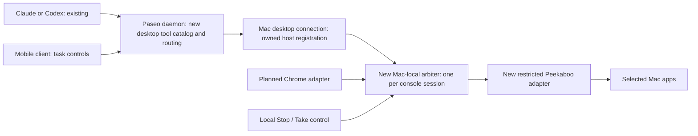

# Shared native macOS desktop control

Status: proposed implementation contract, November 17, 2026. No native backend qualification or live desktop-control test has run.

## TLDR

Let Claude and Codex agents on an authorized Paseo daemon operate a selected Mac through one local desktop-control service. A task owns the screen across observation, action, and verification; competing tasks wait, and the human can take over locally. Use Peekaboo behind that service, subject to cancellation and permission qualification; a timeout never transfers the screen to another task.

## Problem Statement

Several workspaces can need the same physical screen. Separate tools or per-daemon queues cannot stop one agent from typing into the window another agent just focused. Remote agents also need a local executor: connecting a Mac client to a daemon does not make the daemon's plugins execute on that Mac.

The user explicitly requested this native-control follow-up (A4), approved separating the Chrome and notification work (A1), and authorized a separate real Chrome/passkey proof (A2). That proof does not establish safe native input cancellation.

## Scope and related specifications

This spec owns one capability: exclusive native screen use, including the task lifecycle required to stop and hand it over safely. First release supports one active macOS console login and its displays, Claude and Codex, and explicitly selected apps. Treat multiple displays as one resource because keyboard focus is shared.

| Adjacent work                                                        | Contract here                                                                                                                                         |
| -------------------------------------------------------------------- | ----------------------------------------------------------------------------------------------------------------------------------------------------- |
| [Chrome host](2026-11-08-chrome-browser-host.md)                     | Chrome keeps profile/tab ownership. Any Chrome action that may use foreground focus or an authentication dialog also owns this Mac's screen resource. |
| [Mobile attention delivery](2026-11-17-mobile-attention-delivery.md) | Consume durable task attention state and deep-link to it; delivery does not grant control or prove authentication.                                    |
| Existing embedded browser                                            | Preserve current behavior. Do not replace it or claim its tabs provide native screen exclusion.                                                       |

Do not add mobile screen streaming, unattended passkey approval, vault access, clipboard tools, arbitrary shell execution through desktop tools, browser automation, or a cross-platform desktop backend. External programs and agents with direct same-user shell/GUI access can bypass this service; the guarantee covers enrolled Paseo desktop and Chrome adapters only. Do not describe the queue as an OS security boundary.

## Backend decision and prior art

| Candidate                  | Evidence as of November 17                                                                                                                                                                                                                                                                                                                                 | Decision                                                                                                                                                                                             |
| -------------------------- | ---------------------------------------------------------------------------------------------------------------------------------------------------------------------------------------------------------------------------------------------------------------------------------------------------------------------------------------------------------- | ---------------------------------------------------------------------------------------------------------------------------------------------------------------------------------------------------- |
| Peekaboo v4.9.9            | [Release](https://github.com/openclaw/Peekaboo/releases/tag/v4.9.9), [operation locks](https://github.com/openclaw/Peekaboo/blob/v4.9.9/docs/ARCHITECTURE.md), [MCP shutdown/drain](https://github.com/openclaw/Peekaboo/blob/v4.9.9/docs/MCP.md)                                                                                                          | First adapter. Existing operation locks help, but do not reserve a whole multi-call task. Pin this version for qualification; record the exact execution/Bridge host.                                |
| Cua Driver v0.53.0         | [Release](https://github.com/trycua/cua/releases/tag/cua-driver-rs-v0.53.0), [session accounting](https://github.com/trycua/cua/blob/cua-driver-rs-v0.53.0/libs/cua-driver/rust/crates/cua-driver-core/src/session.rs), [ABI cancellation](https://github.com/trycua/cua/blob/cua-driver-rs-v0.53.0/libs/cua-driver/rust/crates/cua-driver-sdk/src/abi.rs) | Alternative if Peekaboo qualification fails. Session cleanup tracks admitted work, but aborting the async caller does not prove every native gesture loop stops. Do not ship two adapters initially. |
| Claude native computer use | [Official contract](https://code.claude.com/docs/en/computer-use): interactive session required; lock lasts until session exit                                                                                                                                                                                                                             | Does not provide a cross-harness task queue or an adapter for remote SDK agents.                                                                                                                     |

Peekaboo wrapper termination is explicitly [process cleanup, not proof of desktop effects](https://github.com/openclaw/Peekaboo/blob/v4.9.9/docs/mcp-testing.md). The implementation must establish a drain acknowledgement for the actual execution host, including held buttons/modifiers. No reviewed source establishes that killing a CLI child universally drains a separate Bridge host. If that cannot be established, stop qualification; do not enable automatic ownership transfer.

## Architecture

The daemon routes and validates agent identity. The Mac arbiter is the final admission authority for every observation and mutation. It combines requests from every connected daemon and every Paseo window; no remote daemon independently grants a screen lease.

### Ownership and deployment

- Implement the arbiter in a local helper managed by the desktop package, outside renderer lifetime. One user/session-wide OS lock protects its control socket across production and development Paseo instances, regardless of `PASEO_HOME`. A second instance attaches to that arbiter or reports it unavailable; it never starts another controller. Test instances use a fake backend unless the user explicitly enables real screen control.
- Use an owner-only local IPC endpoint and a stable local desktop ID, with a new random host epoch on arbiter startup. Peer identity and helper protocol version must be checked. A pathname or task ID alone is not authority.
- A screen resource is the selected desktop ID plus the active console-session identity. Fast user switching, screen lock, sleep, or console-session loss closes admission and starts stopping. Never target another user's session or silently select another Mac.
- The helper owns the adapter and monitors local cancellation independently of renderer and daemon health. Grant macOS Accessibility/Screen Recording to the actual signed executor/Bridge host, following [Peekaboo permissions](https://github.com/openclaw/Peekaboo/blob/v4.9.9/docs/permissions.md). Remote approval cannot grant TCC or unlock the Mac.
- Core owns native execution, host registration, arbitration, and recovery. Plugins may render task cards or notifications using existing SDK surfaces. A remote plugin is not the native host, and there is no claim that current plugin APIs can install this feature without core changes.

### Reuse and changes

| Existing boundary                                                                | Required change                                                                                                                                                   |
| -------------------------------------------------------------------------------- | ----------------------------------------------------------------------------------------------------------------------------------------------------------------- |
| `packages/server/src/server/agent/tools/` and MCP adapter                        | Add provider-neutral desktop tools; stamp agent/workspace identity from the admitted caller.                                                                      |
| `packages/server/src/server/session.ts` host registration and response ownership | Add distinct desktop registration and task observation using owned subscriptions. Accept executor responses only from the registration that received the request. |
| `packages/server/src/server/browser-tools/broker.ts`                             | Reuse the routing pattern, not its most-recent-host selection or timeout semantics. A browser timeout currently does not cancel native work.                      |
| `packages/app/src/runtime/host-runtime.ts` and `desktop/host.ts`                 | Register each opted-in daemon connection against the single local arbiter. Maintain connection generation.                                                        |
| `packages/desktop/src/features/`                                                 | Add helper supervision and typed IPC; no OS control in React or an agent's shell subprocess.                                                                      |
| `packages/client` and `packages/protocol`                                        | Add capability negotiation, owned task observations, and schemas with correlated responses.                                                                       |

### Authority

Use the semantic authorization module, not RPC-name inference. Desktop tool execution requires `workspace.write` on the originating daemon, plus a new explicit Mac-local enrollment for that daemon and selected apps. Existing `workspace.write` grants alone do not enable this feature. Enrollment is disabled by default and can only be created or widened from the local Mac UI; a remote agent cannot enroll itself by connecting a host.

The Mac trusts the enrolled daemon to authenticate and stamp its caller. Bind each task to `(serverId, principalId, workspaceId, agentId, registrationGeneration)`. The host validates that routing provenance against its current enrollment. Agent tool arguments cannot override it. Agent tools can request/release their own task and report attention; they cannot resume human-owned control, cancel another task, widen app access, or clear recovery.

Human task controls require authenticated user/client authority through the daemon; the daemon stamps that provenance separately from agent calls. Keep this distinction explicit at dispatch. It is not an isolation guarantee against a trusted daemon or an unrestricted same-user agent accessing its credentials. Local emergency Stop requires neither network access nor a live remote credential. Revoking local enrollment closes admission before stopping its active task and rejecting queued requests.

## Data Model

The arbiter owns authoritative state. Daemon copies are observations and task-routing records, never locks.

| Record            | Required fields and lifetime                                                                                                                                                                                                                       |
| ----------------- | -------------------------------------------------------------------------------------------------------------------------------------------------------------------------------------------------------------------------------------------------- |
| Enrollment        | Desktop ID, admitted daemon ID, permitted app bundle IDs, enabled flag; persist locally with restrictive permissions and atomic writes. Do not copy daemon credentials into the record.                                                            |
| Human hold        | Screen-level hold ID, reason, revision, creation time, optional originating task; persist before granting human control. Survives task cancellation/archive, disconnect, expiry, and helper restart. Only an authenticated human return clears it. |
| Task              | Opaque task ID, qualified caller identity, selected desktop, bounded user-visible purpose (max 240 chars), app set, queue sequence, state, revision, timestamps, absolute deadline.                                                                |
| Lease             | Host epoch, increasing grant sequence, task ID, registration generation, monotonic expiry; memory only and never restored as active. The host issues it to the transport, not as an agent-selectable credential.                                   |
| Attention         | Task ID, unique attention ID, revision, reason enum, short human instruction, target app, created time, resolved time. No password, clipboard value, passkey, or authentication screenshot fields.                                                 |
| Operation receipt | Task, epoch, operation ID, acceptance/dispatch/completion status, error category. The same operation ID with different arguments is rejected. Retain receipts for the task lifetime; no input text or screenshots in the recovery journal.         |

Use a helper-owned atomic JSON journal for task metadata and the last dispatch marker, following the repository's store-surface rules. It lives in the user-wide desktop-control data directory, not a per-worktree daemon home. Persist a dispatch marker before executing input; a missing completion after restart means uncertain execution. Keep unresolved recovery records until acknowledged, and remove terminal task metadata after seven days. Notification text contains app and purpose only; treat purpose as user-visible free text, never a place for secrets.

Snapshots are task-scoped transient outputs and do not enter the recovery journal. They may enter the owning agent's existing transcript/retention path; explain that in local opt-in. Default capture targets the permitted app window, not the entire desktop. Block capture and input while the human owns control. Backend temporary captures must use private files and be removed after delivery or failure. Do not promise sensitive-content redaction from arbitrary pixels.

## Task lifecycle and queue

| State                                                        | Input authority    | Transition                                                                                                                                                                                                         |
| ------------------------------------------------------------ | ------------------ | ------------------------------------------------------------------------------------------------------------------------------------------------------------------------------------------------------------------ |
| `queued`                                                     | None               | FIFO grant after the preceding owner is drained; requester still connected and authorized.                                                                                                                         |
| `active`                                                     | Owning task only   | Complete, request attention, Take control, Cancel, or loss of authority initiates stopping.                                                                                                                        |
| `stopping`                                                   | No new operations  | Cancel pending work and drain admitted execution. On success enter the intended terminal state or `human_control`; otherwise `recovery_required`.                                                                  |
| `human_control`                                              | Human only         | Persist a screen-level human hold; other tasks remain queued. Continue atomically clears the matching hold and revalidates the live task before a new lease. Cancel terminates the task but leaves the human hold. |
| `recovery_required`                                          | None through Paseo | Local recovery verifies executor quiescence and clears held input. It never offers a force-grant to another task.                                                                                                  |
| `completed`, `cancelled`, `expired`, `interrupted`, `failed` | None               | Terminal; a new request is a new task.                                                                                                                                                                             |

A task retains its screen reservation while waiting for authentication. An unbounded wait would starve all other agents, so show elapsed time and queue count with Continue/Cancel; the default attention deadline is 15 minutes. On expiry, terminate the waiting task but keep the persisted screen-level human hold until the user explicitly returns it to automation. Do not start the next queued task while the user may still be in a password prompt.

Proposed initial limits: 20 queued tasks per screen, one outstanding task per agent per screen, 30-minute task deadline, 5-second owner liveness heartbeat, and 30-second lease expiry. Heartbeats are sent only while the original requester's agent task remains live; agent interruption/archive revokes its task. Network expiry closes admission immediately, even if draining takes longer. These are product defaults, not claims about backend stop latency. Operation deadline is at most 30 seconds and bounded by the remaining task time; typing is bounded to 4,096 characters and native gestures to 5 seconds. No long-running scripts or background backend jobs in v1.

Cancellation is idempotent and acknowledges `stopping`, not `cancelled`. Terminal cancellation requires the executor's drain/cleanup acknowledgement. Lease expiry, transport disconnect, and timeout are revocation signals, never evidence of drain. If an operation's outcome is uncertain, do not replay it. Keep the screen unavailable until quiescence is established, then require a fresh observation before deciding what to do next.

Take control closes admission immediately and persists the human hold before acknowledging takeover; the visible state remains Stopping until drain. A failed hold write enters recovery. A clean restart with a human hold remains human-owned even if its original task is terminal. Generic Return control clears the hold and reopens FIFO only after quiescence; it never resurrects a terminated task.

Within a lease, serialize every native operation, including captures: one executing operation and at most eight pending operations per screen. Deduplicate operation IDs before enqueue; an identical in-flight duplicate returns the existing receipt and cannot create a second dispatch. Record each receipt before acceptance, and revalidate lease, console session, snapshot generation, and allowed target at dispatch. Stopping rejects pending operations before cancellation/drain of the single executing operation. The journal therefore has at most one in-flight dispatch marker.

Host restart creates a new epoch and rejects all old leases, replies, snapshot refs, and Continue actions. Pending tasks become interrupted; none auto-resume. A stale journal dispatch marker enters recovery. Acquiring the helper lock after a crash proves only that the old helper exited, not that a detached Bridge finished.

## API Contracts

Proposed new feature gate: optional `server_info.features.desktopControl`. A compatible client advertises its desktop-host behavior at its connection boundary. Require feature support once before registration/tool exposure; otherwise tell the user to update that host. Existing embedded browser behavior is unchanged.

Every new session RPC uses `.request` / `.response` pairs under the prefixes below. Requests carry `requestId` and parameters at the top level; responses carry `{ requestId, result, error }` under `payload`. New message fields are structural and pure; existing wire fields are neither removed nor narrowed. Unsupported peers never receive new event/message kinds. Observations follow existing owned subscription lifecycle and authorization, including reconnect and release.

| Prefix                                                      | Input                                                                    | Result                                                                                                                                                     |
| ----------------------------------------------------------- | ------------------------------------------------------------------------ | ---------------------------------------------------------------------------------------------------------------------------------------------------------- |
| `desktop.host.register`                                     | Desktop identity, current epoch, backend/version, permitted capabilities | Source-owned registration ID. Executor responses bind to this registration.                                                                                |
| `desktop.task.acquire`                                      | Selected desktop ID, purpose, requested app set, client request key      | Task ID, revision, state, queue position; return promptly rather than holding an MCP call through a human wait.                                            |
| `desktop.task.get` / `desktop.task.observe`                 | Task ID; observation options follow the owned-subscription contract      | Authorized snapshot/updates with monotonic revision. Remote clients see their daemon's tasks and aggregate foreign queue count, not foreign task contents. |
| `desktop.task.execute`                                      | Task ID, operation ID, typed operation, snapshot reference where needed  | Accepted/completed receipt or typed failure; daemon attaches the lease/provenance.                                                                         |
| `desktop.task.request_attention`                            | Owned task ID, reason, instruction                                       | Attention ID and stopping state; publish attention as ready only after drain.                                                                              |
| `desktop.task.finish` / `desktop.task.cancel`               | Task ID                                                                  | Stopping/terminal snapshot; agent can affect only its own task.                                                                                            |
| `desktop.task.continue`                                     | Task ID, attention ID, expected revision                                 | Human-only transition to a new lease; exact accepted retry returns its receipt, unaccepted superseded revision or lost authority fails.                    |
| `desktop.host.take_control` / `desktop.host.return_control` | Selected desktop ID and expected revision                                | Human-only takeover/return; local UI calls the same arbiter without a remote round trip.                                                                   |

Add source-bound `desktop.host.dispatch` and `desktop.host.cancel` request/response pairs for daemon-to-executor traffic, with task/operation IDs, registration generation, epoch and grant sequence. The cancellation response distinguishes admission closed from executor drained. Only a drained response can release the resource. Host liveness/lease renewal belongs to this typed transport; agent prose or a browser message cannot renew a lease.

V1 typed operations: list permitted apps/windows, activate a permitted window, observe/capture that window, click, bounded type, keypress, scroll, and bounded drag. Convert opaque snapshot references to app/window targets only inside the adapter. Reject arbitrary command strings, arbitrary paths, or raw backend tool forwarding. Before each operation, recheck ownership, epoch, console session, allowed app, and current snapshot generation; coordinates are relative to the captured window and invalid after move/resize/display changes.

Errors distinguish `not_enrolled`, `not_authorized`, `host_unavailable`, `permission_required`, `queue_full`, `stale_lease`, `stale_snapshot`, `human_control`, `cancelled_before_dispatch`, `outcome_unknown`, and `recovery_required`. A retryable transport error never implies a mutation is safe to retry. Keep completed operation receipts for duplicate requests; after epoch loss return interrupted/outcome unknown rather than executing an old request anew.

## UI/UX

Desktop setup names the Mac, enrolled daemon, permitted apps, execution backend, and TCC readiness. Enabling screen access is an explicit local action separate from ordinary host pairing. Do not infer opt-in from existing browser-tools settings.

A persistent local control indicator shows owner workspace/agent, elapsed time, queue count, and **Take control** / **Stop**. Provide a local emergency shortcut implemented outside React and tested with the chosen executor; do not claim a shortcut can interrupt already dispatched native input instantly. State changes to **Stopping** until cleanup is confirmed. If the helper is unhealthy, show **Recovery required** and local recovery instructions, not **Released**.

Mobile and desktop task cards share Queued, Using Mac, Stopping, Needs you, Recovery required, and terminal states. The card names the target Mac and app. **Continue** and **Cancel** operate on the current attention revision. Continue authorizes a fresh observation; the agent must verify the manual step succeeded. Notification taps only open the card. A phone cannot fulfill Mac Touch ID, unlock the screen, or grant Accessibility.

Preserve current keyboard focus when queue updates arrive; never focus Chrome or another app merely to show a notification. Give controls accessible labels, keyboard operation on desktop, and text status alongside color. Use existing cross-platform panels and notification-open routing; no new mobile navigation ownership model.

## Chrome and attention coordination

Acquire resources in one order: Chrome profile/tab reservation first, then the Mac screen. Release in reverse. A native task owns only the screen and cannot synchronously acquire a Chrome profile while holding it; release/requeue or keep the work in the existing Chrome task. This prevents circular waits.

For the first shared release, real-Chrome tasks reserve the screen for their whole task, including passkey attention, because backend focus behavior is not yet qualified for background concurrency. Embedded DOM-only work can remain independent. The Chrome adapter must enter the same arbiter before any native/foreground action; separate Chrome and desktop queues must never each grant the same screen. Do not advertise cross-adapter exclusion until that wiring is tested.

Persist the accepted Continue outcome keyed by caller, task, attention ID, and expected revision before acknowledging it. An exact retry returns the recorded outcome plus current task state, without another lease grant or clearing a later human hold. A superseded revision that was never accepted fails. After restart, a recorded success does not restore execution: return that receipt with the current interrupted/recovery state.

Attention state is durable independently of notification delivery. Identify it by `(serverId, desktopId, taskId, attentionId, revision)`; duplicate delivery or taps cannot resume twice. A delivery failure leaves the card actionable. Push payloads carry routing IDs and generic wording, not passwords, typed text, screenshots, or full URLs.

FSH Android push exists in current fsh: [PR #119](https://github.com/fullstackhouse/paseo/pull/119), merged November 17, enables Expo/Firebase. The checkout used for the original inspection predated that change. The separate attention spec covers the remaining desktop-present routing and actual-device evidence; this feature must not add another push transport or assume mobile receipt from a notification API acknowledgement.

## Failure Scenarios and recovery

| Trigger                                            | Required behavior                                                                                                                                                                  |
| -------------------------------------------------- | ---------------------------------------------------------------------------------------------------------------------------------------------------------------------------------- |
| Daemon/socket disappears mid-drag                  | Close admission, revoke epoch/grant, drain execution and release held input; no new owner until acknowledgement.                                                                   |
| Backend reports timeout but still runs             | Recovery required; do not retry or advance FIFO.                                                                                                                                   |
| Renderer crashes or another Paseo window opens     | Local arbiter retains authority; new renderer observes it, never creates its own queue.                                                                                            |
| Helper dies with Bridge work pending               | Restart in recovery; verify exact executor identity and pending work before returning control.                                                                                     |
| Human takes control or enters authentication       | Stop accepted work, then reserve for the human; suppress captures and queued automation.                                                                                           |
| User input during an active task                   | Do not promise perfect automatic detection. Explicit takeover is the supported boundary; any available physical-input detection pauses conservatively and is separately qualified. |
| Screen locks, user switches, TCC revoked           | Stop; report local action needed. Never attempt to unlock or grant permission through the agent.                                                                                   |
| Agent stops, archives, or loses authority          | Cancel queued request or stop active work; remote heartbeat cannot keep an abandoned task alive.                                                                                   |
| Notification delayed or duplicate Continue arrives | Read current revision; stale actions do nothing and return current state.                                                                                                          |
| Helper storage write fails                         | Do not dispatch an unjournaled mutation; keep active work stopping/recovery if completion persistence is uncertain.                                                                |

Local recovery closes admission, identifies and drains the exact executor, releases only inputs held by that executor, invalidates targets, and records a new epoch. A human may disable the feature without recovering it, but cannot click past unknown in-flight execution to grant another agent control. Clearing metadata alone is not recovery.

## Risks and rollout

The main risks are unverified native cancellation, granting a trusted remote daemon access to the Mac, focus changes outside Paseo, and sensitive screenshots entering agent transcripts. Local opt-in, bounded typed operations, and fail-closed ownership address the supported path; none isolate arbitrary same-user programs.

Ship disabled by default after backend qualification. Disable/revoke first closes admission, drains, and detaches registrations; it does not close user apps or erase 1Password state. Uninstall refuses to claim cleanup while execution is uncertain and gives local recovery steps. Rollback disables the new capability while retaining inert recovery metadata until it is safe to remove. No automatic backend upgrades: a new binary/Bridge combination repeats qualification.

## Phasing

1. Qualify the backend and local arbiter using a native input-counting fixture, with feature exposure disabled.
2. Add authenticated remote routing and provider-neutral tools, still opt-in.
3. Add human controls, durable attention cards, and Chrome-arbiter participation; enable the shared workflow only after the acceptance matrix passes.

## Implementation Plan

1. **Backend qualification:** pin Peekaboo and actual Bridge/execution host; document TCC ownership. Against a disposable native fixture, cancel before dispatch, during typing and drag, and during blocked native work. Verify no late input after drain, required button/modifier releases, and fresh screenshot validity. Failure blocks enablement; do not replace this evidence with CLI exit codes.
2. **Local ownership:** build the helper, single-console lock, task store, FIFO admission, epochs, receipts, and watchdog. Test two daemon connections, two desktop instances, queue bounds, expiry, journal failure, stale dispatch, concurrent operations from one owner, and duplicates arriving before completion. Fake backends model delayed and noncooperative operations deterministically.
3. **Transport and authority:** add feature-negotiated registration, RPCs, owned observations, and semantic classification. Test forged executor responses, other-agent task IDs, disconnected subscriptions, revoked enrollment, and version drift. Existing browser calls remain usable.
4. **Claude/Codex path:** expose common tools through the existing catalog; run local and remote tasks with each provider against the disposable fixture. Stop/archive an agent mid-operation and verify the screen stays unavailable until drained. Do not add provider-auth checks to tests.
5. **Human handoff:** add local indicator/shortcut and client task cards. Verify takeover with the daemon offline, renderer crashes, attention expiry, cancellation/archive during human control, clean-journal restart with a human hold, stale Continue, a lost successful Continue response followed by retry, screen lock, and permission loss. Record UI/console evidence in the actual dev window, without secrets.
6. **Chrome coordination:** integrate the Chrome adapter with the same arbiter and lock order. Run a native task and Chrome passkey task concurrently; prove the native task cannot focus/type during the human authentication interval. A2's single-task proof is prerequisite evidence, not a substitute for this test.
7. **Release evidence:** use existing unit/integration suites and targeted desktop E2E jobs, not a new full-suite runner. Record exact binary versions, two-daemon tests, cold restart, recovery, protocol compatibility, and attention-delivery limits. Run typecheck, lint, and format; use CI for broad suites. Do not restart the main daemon for qualification.

## Evidence and review limits

Repository contracts: [architecture](../architecture.md), [permissions](../permissions.md), [connected hosts](../connected-hosts.md), [data model](../data-model.md), [protocol compatibility](../protocol-compatibility.md), [RPC naming](../rpc-namespacing.md), [notification routing](../notifications.md), and [plugin boundaries](../plugins.md).

This document specifies future behavior. Source review establishes existing routing and candidate backend behavior only. No live TCC, takeover, cancellation-latency, recovery, cross-harness native-control, or phone-delivery result is claimed. The backend drain qualification is an explicit implementation acceptance gate, not an unresolved product-scope question.

Architectural review found two lifecycle gaps: human ownership tied to task lifetime, and concurrent operations within one lease. This revision adds a persisted screen-level human hold and one executing native operation per screen. Review is document-based; the qualification matrix remains unrun.
