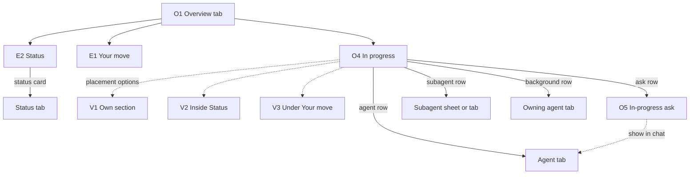

# Overview: work in progress — UI map

Companion to [the spec](./spec-overview-in-progress.md). Every view, every change to an existing screen,
and how you move between them.

## Baseline

Paseo FSH fork `fsh` at b245e51ae (2026-11-24), Overview as approved in [spec-overview-tree](./spec-overview-tree-ui-map.md).

Where in-progress work shows today, none of it on Overview:

- **Sidebar row**: a spinning ring while the workspace counts as running (an agent turn, subagents,
  monitors, background shells). No count, no names.
- **Agent tabs strip**: a ring on an agent's icon while its turn runs.
- **Composer bar** of one agent: subagents pill ("3 working", "1 failed", "2 ready to review"),
  status pill ("working · 8h", "· stale" after 2 turns), Asks pill (open asks only, hidden at 0).
- **Explorer tabs**: Status (cards, "N turns since"), Asks ("Needs you" and "In progress" sections),
  Lineage (agents with a ring while running).
- **Overview**: Status shows the card's word ("Working") with no age; Your move shows only what waits on
  you, plus "Archive waits for background work" once the work shipped; Tree shows child workspaces'
  state words and "· N agents" on this workspace's row. A running agent, subagents, background shells
  and in-progress asks appear nowhere.

## Navigation

Overview stays a tab in the Explorer sidebar on desktop and the workspace sheet on mobile
([docs/explorer-sidebar.md](../docs/explorer-sidebar.md)). Nothing moves in the app's menus. The tab
reads top to bottom, new and changed parts marked:

1. Identity — title, goal (unchanged).
2. Status — state word and summary, now with the card's age and a warning when it says Working but
   nothing runs (E2).
3. Waiting on — PR, person, other blockers (unchanged).
4. Your move — what waits on you (E1).
5. **In progress** — what is moving without you: agents, subagents, background work, asks the agent
   has taken on (O4, new).
6. Tree — lineage, blocked by, blocking (unchanged).
7. Context — plugin facts (unchanged).
8. Pull requests (unchanged).

No permissions: everything on Overview is visible to whoever can open the workspace.

## Flow

## O — Overview tab

- **O4 In progress** (P1) — new section after Your move: one row per thing moving without the human.
  Running agents (title, "working · 3m"), subagents grouped under their agent ("3 subagents working"),
  background work an idle agent left running (shell or monitor name, "running · 2h"), asks in progress
  (title, what it waits on, age). Hidden when nothing is in progress. Get here: Overview tab. Permission:
  none.
- **O5 In-progress ask** (P1, expanded row on O4) — the ask's title and body, read-only, with what it
  waits on, when the agent took it and when it last moved. Get here: an ask row on O4. Permission: none.

## V — Placement options (A4)

Three ways to place in-progress work on Overview, drawn on the same workspaces so they compare
directly. One is chosen in A4; the others are dropped, and O4 takes the winner's anatomy.

Views: V1 Own section, V2 Inside Status, V3 Under Your move.

## E — Existing screens

- **E1 Your move** (P1) — changed: "Archive waits for background work" leaves (O4 shows that work);
  Archive also waits while asks are in progress. Get here: Overview tab. Permission: none.
- **E2 Status** (P1) — changed: the card's age ("updated 8h ago"); when it says Working and nothing runs
  in the workspace, a warning line "Nothing is running". Get here: Overview tab. Permission: none.

## Later phases (scope only)

- Handing back in-progress asks nothing is driving (a reminder to the agent, then the ask reopens for the
  human).
- Sidebar grouping: a workspace whose only open items are in progress and backed shows as Working, not
  Ready to review.

## Decisions (stage 1, 2026-11-25)

1. In progress lists all four kinds: agents with a running turn, their subagents, background work an
   idle agent left running, and asks in progress (A5).
2. Grouped: one row per agent and per ask; each agent's subagents and background work fold under it as
   counted lines (A6).
3. Placement: its own "In progress" section directly after Your move (V1). V2 and V3 are dropped; O4
   takes V1's anatomy (A4).

## Open questions

See the stage 1 asks (A7–A11).
