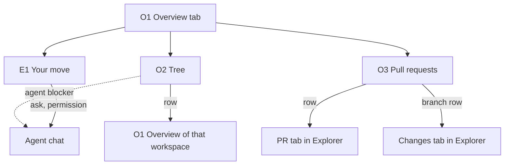

# Overview: tree and PRs — UI map

Companion to [the spec](./spec-overview-tree.md). Every view, every change to an existing screen, and how
you move between them.

## Navigation

Overview is a tab in the Explorer sidebar on desktop and in the workspace sheet on mobile
([docs/explorer-sidebar.md](../docs/explorer-sidebar.md)). Nothing moves in the app's menus. The tab
reads top to bottom:

1. Identity — title, goal (unchanged).
2. Status — state word, summary (unchanged).
3. Waiting on — non-workspace blockers (a person, a PR, other); workspaces are in O2 (A15).
4. Your move — asks, permissions, failed agents, Archive once shipped (E1).
5. Tree — parent chain, children, blocked by, blocking (O2).
6. Context — plugin facts only; From, Started and Agents move to O2, PR/branch to O3 (A18).
7. Pull requests — last thing on the tab (O3).

No permissions: everything on Overview is visible to whoever can open the workspace.

## Flow

## O — Overview tab

Views: O1 Overview tab, O2 Tree, O3 Pull requests.

## E — Existing screens

Views: E1 Your move, E2 Context footer.

## Later phases (scope only)

- Workspace header git button: unchanged by this spec.

## Decisions (stage 1, 2026-11-23)

1. Archive stays in Your move once the work shipped; every other git row goes (A1).
2. The failing-checks row leaves Your move; the PR row in O3 turns red instead (A2).
3. O3 lists every PR paseo-prs relates to the workspace (branch, stack, linked); without paseo-prs, the
   host's branch PR (A3).
4. With no PR: one "No PR yet" row with the branch facts, branch name muted; opens Changes (A4).
5. Tree depth: ancestors up to the root, this workspace, direct children with their own child count (A5).
6. Workspace and agent blockers move into the Tree; PR, person and other blockers stay in the top
   Blocked by block (A6).
7. The Tree sits directly after Your move (A7).
8. The workspace header's git button is out of scope (A8).
