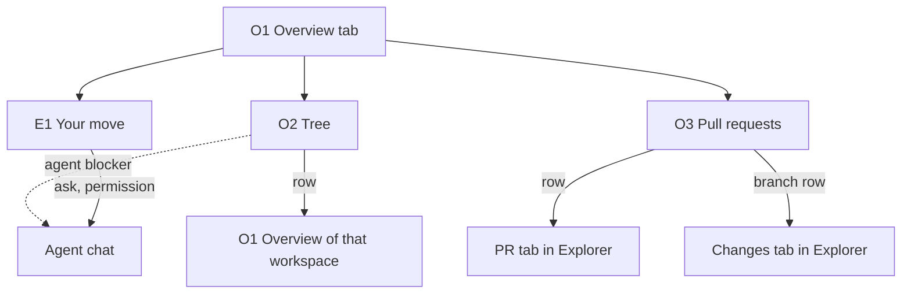

# Overview: tree and PRs — UI map (stage 1)

Companion to [the spec](./spec-overview-tree.md). Every view, every change to an existing screen, and how
you move between them.

## Navigation

Overview is a tab in the Explorer sidebar on desktop and in the workspace sheet on mobile
([docs/explorer-sidebar.md](../docs/explorer-sidebar.md)). Nothing moves in the app's menus. The tab
reads top to bottom:

1. Identity — title, goal (unchanged).
2. Status — state word, summary (unchanged).
3. Blocked by — only non-workspace blockers (a person, a PR, other); see O2.
4. Your move — asks, permissions, failed agents, Archive once shipped (E1).
5. Tree — parent chain, children, blocked by, blocking (O2).
6. Context — Agents count and plugin facts (unchanged, minus From/Started/PR/branch rows).
7. Pull requests — last thing on the tab (O3).

No permissions: everything on Overview is visible to whoever can open the workspace.

## Flow

## O — Overview tab

- **O1 Overview tab** (P1) — the whole tab in its new order, at desktop and mobile widths. Get here:
  Overview tab in the Explorer sidebar, or the workspace sheet on mobile.
- **O2 Tree** (P1) — where the workspace sits: parent chain above, children below, workspaces it is
  blocked by and that it blocks. Each row: workspace name, one state word, chevron; opens that
  workspace. Hidden when the workspace has no relations. Get here: section of O1.
- **O3 Pull requests** (P1) — the workspace's PRs: number, title, checks/review facts in one line, open
  ones first. With no PR, one row for the branch's unpushed or unreviewed work. Hidden when there is
  neither. Get here: last section of O1.

## E — Existing screens

- **E1 Your move** (P1) — loses the git step row (Create PR, Push, Pull, Merge from base) and the
  failing-checks row. Keeps asks, permissions, failed agents and Archive once the work shipped. Get
  here: section of O1.
- **E2 Context footer** (P1) — loses From, Started (now in O2) and the PR/branch row (now O3). Keeps
  Agents and plugin facts. Get here: section of O1.

## Later phases (scope only)

- Workspace header git button: unchanged by this spec.
