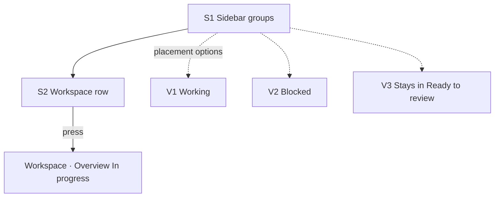

# Sidebar: work in progress — UI map

Companion to [the spec](./spec-sidebar-in-progress.md). Every view, every change to an existing screen, and
how you move between them.

## Baseline

Paseo FSH fork `fsh` at ae781d529 (2026-11-25), with Overview's In progress section (#237) and paseo-asks
`inProgress` entries (#91).

The sidebar today:

- **Groups**, top to bottom: Needs input, Failed, Ready to review, Working, Done, Blocked. An idle workspace
  goes to Ready to review when its last turn finished, unless a plugin report moves it: paseo-status's card
  (Working, Blocked, Done; a Working card counts only while something ran in the last 5 minutes) or
  paseo-asks' open asks (needs you → Ready to review).
- **Workspace row**: title, project, and a line of badges: "needs you (3)" from open asks, plugin badges,
  the time since last activity. A spinning ring while running.
- **In-progress asks** count nowhere in the sidebar; only Overview's In progress section lists them.

## Navigation

Nothing moves in the app's menus. The sidebar keeps its groups and their order; what changes is which group
an idle workspace with in-progress work lands in (S1) and what its row says about that work (S2).

## Flow

## S — Sidebar

Views: S1 Sidebar groups, S2 Workspace row.

## V — Placement options

Three groups a workspace with only moving in-progress work could land in, drawn on the same sidebar so they
compare directly.

Views: V1 Working, V2 Blocked, V3 Stays in Ready to review.

## Later phases (scope only)

- The row's hover card names what each in-progress item waits on.
- Automatic hand-back of stuck asks (its own spec).

## Decisions (stage 1, 2026-11-25)

1. Group by what the in-progress work waits on (A27): on machines (CI checks running, a live background job,
   a running turn) → **Working**; only on a person other than you (a requested review) → **Blocked**. Mixed
   → Working, as the existing fold ranks working work above blocked. V1 and V2 are both kept, each for its
   case; V3 is dropped.
2. A workspace with in-progress work that nothing moves stays in Ready to review, with a warning badge
   "N not moving" (A28).
3. The "N in progress" badge shows only where in-progress work explains the row's group (under Working or
   Blocked because of it); "N not moving" shows wherever it applies (A29).
4. Moving in-progress work wins over a Done status card: the row stays under Working or Blocked until the
   work finishes or is handed back (A30).
5. Stage 1 approved (A31).
